# sortmancy

Pixel sorting and glitch magic for Go: a command line tool and a library

**[Documentation and gallery →](https://marcr11.github.io/sortmancy/)** · **[Try it in your browser →](https://marcr11.github.io/sortmancy/playground/)**

[](https://pkg.go.dev/github.com/MaRcR11/sortmancy)
[](https://github.com/MaRcR11/sortmancy/actions/workflows/ci.yml)
[](LICENSE)
[](https://marcr11.github.io/sortmancy/)

Original | Sorted by hue between edges | Spiral sort | Animated sweep
-------- | ----------------------------- | ----------- | --------------
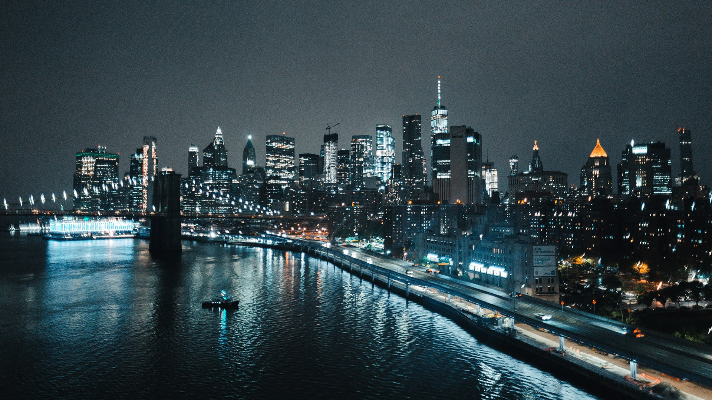 | 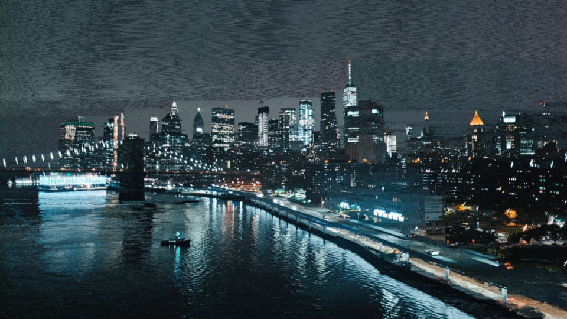 | 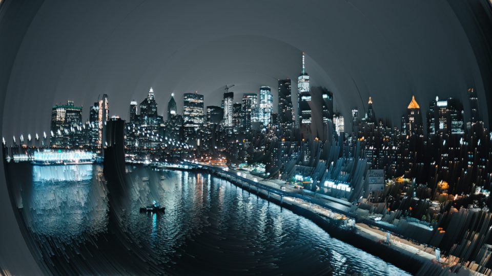 | 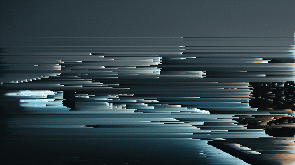

- **Pixel sorting**, modelled on the usual tools (satyarth/pixelsort, ASDF, Acerola):
  - 13 sort keys: lightness, luminance, hue, saturation, value, chroma, single channels, and more.
  - Interval functions: threshold, random, waves, edges, none.
  - Paths: straight lines at any angle, sine waves, flow fields, contours, spirals, Hilbert curves, concentric rings, radial rays.
  - Span modes: sort, shuffle, average, gradient, smear, per-channel, mirror.
  - Tile sorting, masks, intervals taken from another image, reverse order, randomness, reproducible seeds.
- **74 operations** in total:
  - Color: blend modes, auto-levels, histogram equalization, levels, curves, temperature, sepia, channel mixer, `.cube` LUTs and built-in film looks, gradient map, hue, posterize, ...
  - Glitch: RGB shift, chromatic aberration, slice glitch, block shuffle, JPEG corruption, data bending, echo, interlace, pixel scatter, VHS tracking, melt, wave, scanlines, noise.
  - Distortion: displacement maps, swirl, ripple, bulge/pinch, polar coordinates, CRT curvature, slit-scan.
  - Retro: 10 dithering algorithms with retro palettes, median-cut quantization.
  - Artistic: ASCII art, low-poly and Voronoi mosaics, toon, neon edges, emboss, halftone, bloom, oil paint, kaleidoscope, tiling, droste.
  - Geometry: resize, crop, pixelate, mirror, flip, rotate.
  - Filters: blur, sharpen, edges, vignette.
- **Masks and regions**: every operation can be limited to part of the image with `--region`, `--mask`, `--invert-mask` and `--feather`.
- **Pipelines**: chain operations, e.g. `"sort angle=90 | glitch | dither palette=gameboy"`.
  `mix` blends the result with the original, and `resize original` scales back to the input size.
- **20 presets**: ready-made looks such as `@vhs`, `@vaporwave`, `@crt`, `@cinematic`, `@noir`, `@comic`, `@neon` and `@chunky`.
- **Animation**: sweep any parameter with `{from..to}` to create GIFs or frame sequences.
  Animated GIF input is processed frame by frame.
- **Formats**: reads PNG, JPEG, GIF, BMP, TIFF and WebP; writes all of them except WebP.
  stdin/stdout are supported.
- **Batch processing**: process whole folders or glob patterns in one call.
- **Web playground**: try every operation and preset in the browser, compiled to WebAssembly; images never leave your computer.
- **Fast**: work is spread across all CPU cores. Sorting a 1080p image takes about 40 ms.
- **Minimal dependencies**: the standard library plus `golang.org/x/image`.

## Installation

```bash
go install github.com/MaRcR11/sortmancy/cmd/sortmancy@latest      # Go 1.21 or newer

docker run --rm -v "$PWD:/work" ghcr.io/marcr11/sortmancy @vhs -i in.jpg -o out.png
```

Precompiled binaries for Windows, Linux and macOS are also on the [releases](https://github.com/MaRcR11/sortmancy/releases) page.

Use it as a library:

```bash
go get github.com/MaRcR11/sortmancy
```

## Command line

```text
sortmancy <operation> -i <input> -o <output> [--param value | param=value ...]
sortmancy run -i <input> -o <output> "<op> [params] | <op> [params] | ..."
sortmancy @<preset> -i <input> -o <output>
sortmancy -i <input> -o <output> [-t <0-255>]      (classic threshold sort)

sortmancy list          list all operations
sortmancy presets       list all presets
sortmancy help <op>     show the parameters of an operation
```

| Option | Description |
| ------ | ----------- |
| `-i, --input`   | input image, a folder, a glob such as `"photos/*.jpg"`, or `-` for stdin |
| `-o, --output`  | output image (the extension selects the format), a folder for batch input, `frame%03d.png` for numbered frames, or `-` for stdout |
| `-f, --format`  | output format, overriding the extension: png, jpg, gif, bmp, tiff |
| `-q, --quality` | JPEG quality 1–100 (default 95) |
| `--seed`        | seed for random operations; printed when omitted so results can be reproduced |
| `--frames`      | render an animation with this many frames |
| `--delay`       | frame delay in ms (default 80, or the input GIF's own delays) |
| `--pingpong`    | sweep parameters there and back so the animation loops seamlessly |
| `--quiet`       | no progress output |
| `-t, --threshold` | classic mode: sort pixels with luminance ≥ t (0–255) |

You can write parameters as `--name value`, as `name=value`, or positionally in the order that `sortmancy help <op>` lists them:

```bash
sortmancy sort -i in.jpg -o out.png --angle 90 --key hue
sortmancy sort -i in.jpg -o out.png interval=edges edge=0.2 reverse
sortmancy pixelate -i in.jpg -o out.png 12
sortmancy glitch -i in.jpg -o out.png --region 0,0,1920,430
sortmancy run -i in.jpg -o out.png "sort angle=45 lower=0.4 | shift | scanlines"
sortmancy @vhs -i in.jpg -o out.png
sortmancy run -i in.jpg -o out.png "@chunky | @crt"
```

### Animation

Write `{from..to}` in any parameter to sweep it across the frames:

```bash
sortmancy run -i in.jpg -o anim.gif --frames 30 --pingpong "sort angle={0..90} lower={0.05..0.5}"
sortmancy run -i in.jpg -o frames/f%03d.png --frames 60 "glitch seed={1..60}"
sortmancy run -i animated.gif -o sorted.gif "sort angle=90"
```

### Batch and pipes

```bash
sortmancy run -i "photos/*.jpg" -o sorted/ "sort angle=90"
sortmancy @vaporwave -i photos/ -o out/ --format png
cat in.png | sortmancy @crt -i - -o - > out.png
```

The original interface still works: `sortmancy -i img/city/city.jpg -o out.jpg -t 128`.

### Sorting

`sortmancy help sort` lists all parameters. The main ones:

| Parameter | Values | Default | |
| --------- | ------ | ------- | - |
| `key` | lightness, luminance, hue, saturation, value/brightness, intensity, minimum, chroma, red, green, blue, alpha | lightness | what pixels are ordered by |
| `interval` | threshold, random, waves, edges, none | threshold | how lines are cut into sorted spans |
| `lower`, `upper` | 0–1 | 0.25, 0.8 | threshold: only pixels in this range are sorted |
| `threshold-key` | any key | lightness | threshold: which value is compared |
| `length` | pixels | 50 | random / waves: span length |
| `edge` | 0–1 | 0.25 | edges: edge strength that stops a span |
| `path` | linear, wave, flow, contour, spiral, hilbert, concentric, radial | linear | how the image is traversed |
| `angle` | degrees | 0 | linear: 0 = left→right, 90 = bottom→top, any angle works |
| `amplitude`, `wavelength` | pixels | 20, 200 | wave path |
| `vertical` | flag | | wave / flow / contour path: run the lines vertically |
| `flow-scale` | pixels | 150 | flow path: size of the swirls |
| `warp` | pixels | 60 | flow / contour path: how far lines bend |
| `contour-blur` | pixels | 4 | contour path: smoothing of the brightness that bends the lines |
| `spacing` | pixels | 4 | spiral path: distance between turns |
| `cx`, `cy` | 0–1 | 0.5, 0.5 | center of spiral / concentric / radial paths |
| `mode` | sort, shuffle, average, gradient, smear, channels, mirror | sort | what happens to each span |
| `reverse` | flag | | sort high→low |
| `randomness` | 0–1 | 0 | chance to skip a span |
| `tile` | pixels | 1 | sort square tiles of this size instead of single pixels |
| `interval-image` | image file | | take the intervals from another image instead of the input |
| `mask`, `invert-mask` | image file | | only sort the white (or black) areas of a mask |

### All operations

| Group | Operations |
| ----- | ---------- |
| Sorting | `sort` |
| Color | `invert`, `grayscale`, `threshold`, `posterize`, `brightness`, `contrast`, `gamma`, `saturation`, `hue`, `solarize`, `swap` (channel swap), `gradientmap`, `autolevels`, `equalize`, `levels`, `curves`, `temperature`, `sepia`, `channelmix`, `lut` (`.cube` files and built-in looks) |
| Glitch | `shift` (RGB split), `aberration`, `glitch` (slice displacement), `blocks` (block shuffle), `jpeg` (data corruption), `bend` (data bending), `echo`, `interlace`, `scatter`, `tracking` (VHS), `melt`, `wave`, `scanlines`, `noise` |
| Distortion | `displace`, `swirl`, `ripple`, `bulge`, `polar`, `curvature`, `slitscan` |
| Retro | `dither` with `floyd`, `atkinson`, `jarvis`, `stucki`, `burkes`, `sierra`, `bayer2/4/8` or `none`, palettes `bw`, `gray4`, `gameboy`, `cga`, `pico8`, `c64`, `sepia`, `vapor`, `websafe` or your own `#hex,#hex,...`; `quantize` (best N colors) |
| Artistic | `ascii`, `voronoi`, `lowpoly`, `toon`, `neon`, `emboss`, `halftone`, `bloom`, `oilpaint`, `kaleidoscope`, `tile`, `droste` |
| Geometry | `resize`, `crop`, `pixelate`, `mirror`, `flip`, `rotate` |
| Filters & blending | `blur`, `gaussian`, `motionblur`, `zoomblur`, `median`, `dilate`, `erode`, `sharpen`, `edges`, `vignette`, `mix`, `blend` (13 blend modes) |

### Presets

| Preset | Pipeline |
| ------ | -------- |
| `@classic` | `sort key=luminance threshold-key=luminance lower=0.5 upper=1` |
| `@vertical` | `sort angle=270 interval=edges edge=0.2` |
| `@spiral` | `sort path=spiral spacing=6 interval=edges edge=0.2` |
| `@melt` | `sort angle=270 interval=edges edge=0.15 mode=smear \| melt shift=120` |
| `@glitch` | `sort lower=0.35 randomness=0.5 \| glitch slices=30 \| shift \| jpeg amount=2` |
| `@vhs` | `shift \| wave \| tracking \| noise \| scanlines \| saturation` |
| `@crt` | `bloom \| aberration \| scanlines \| curvature \| vignette` |
| `@vaporwave` | `sort key=hue angle=90 \| gradientmap \| mix 0.6 \| scanlines` |
| `@dream` | `sort path=concentric \| bloom \| saturation` |
| `@gameboy` | `resize scale=0.33 \| dither atkinson palette=gameboy \| resize original filter=nearest` |
| `@8bit` | `resize scale=0.25 \| quantize colors=16 \| resize original filter=nearest` |
| `@chunky` | `resize scale=0.125 \| sort angle=90 \| resize original filter=nearest` |
| `@newspaper` | `grayscale \| contrast 1.4 \| halftone size=6` |
| `@oil` | `oilpaint radius=4 \| saturation 1.2` |
| `@planet` | `polar \| vignette 0.4` |
| `@databend` | `bend delay=12347 feedback=0.6 \| interlace shift=6` |
| `@cinematic` | `autolevels \| lut tealorange \| vignette 0.4` |
| `@noir` | `lut noir \| vignette 0.6 \| noise amount=0.04 mono` |
| `@comic` | `toon \| saturation 1.3` |
| `@neon` | `neon` |

`sortmancy presets` prints the full pipelines.

## Library

```go
import (
	"github.com/MaRcR11/sortmancy/effects"
	"github.com/MaRcR11/sortmancy/imageio"
	"github.com/MaRcR11/sortmancy/pipeline"
	"github.com/MaRcR11/sortmancy/sorter"
)

img, _ := imageio.Load("in.jpg")

// Pixel sort with full control.
out := sorter.Sort(img, sorter.Options{
	Key:      sorter.Hue,
	Interval: sorter.Edges(0.2),
	Path:     sorter.Spiral(0.5, 0.5, 6),
	Mode:     sorter.ModeSort,
	Reverse:  true,
	Seed:     42,
})

// Apply effects. Every effect takes an image.Image and returns a new *image.NRGBA.
glitched := effects.ChannelShift(out, image.Pt(8, 0), image.Point{}, image.Pt(-8, 0))
retro := effects.Dither(glitched, effects.DitherOptions{
	Method:  effects.Atkinson,
	Palette: effects.MedianCut(img, 16),
})

_ = imageio.Save("out.png", retro, imageio.Options{})
```

Or describe the whole chain as a string, the same way the CLI does:

```go
p, err := pipeline.ParseSeed("@chunky | glitch slices=20 | mix 0.7", 42)
out, err := p.Apply(img)

// shortest form
err = sortmancy.ApplyFile("in.jpg", "out.png", "sort angle=45 | vignette")
```

Animations:

```go
anim, _ := imageio.LoadAnimation("in.gif")
frames, _ := pipeline.Animate(anim.Frames, "sort angle={0..180}", pipeline.AnimateOptions{Frames: 30, PingPong: true})
out := &imageio.Animation{}
for _, f := range frames {
	out.Frames = append(out.Frames, f)
}
_ = imageio.SaveAnimation("out.gif", out)
```

**Extending:**
- `sorter.Key` is a plain `func(color.NRGBA) float64`.
- `sorter.IntervalFunc` and `sorter.PathFunc` let you define your own spans and traversals.
- `pipeline.Func` adds any Go function to a pipeline, and `pipeline.SourceFuncOp` adds one that also receives the original input.
- `pipeline.Register` makes a new operation available by name, and the CLI then picks it up too.
- Add an entry to `pipeline.Presets` to define your own `@preset`.

## Gallery

**[See the full gallery on the docs site →](https://marcr11.github.io/sortmancy/docs/gallery/)** It has 172 examples covering every sort option, operation, preset and animation, each with the command and the equivalent Go code.

All examples start from [img/city/city.jpg](img/city/city.jpg).

| | | |
|-|-|-|
| 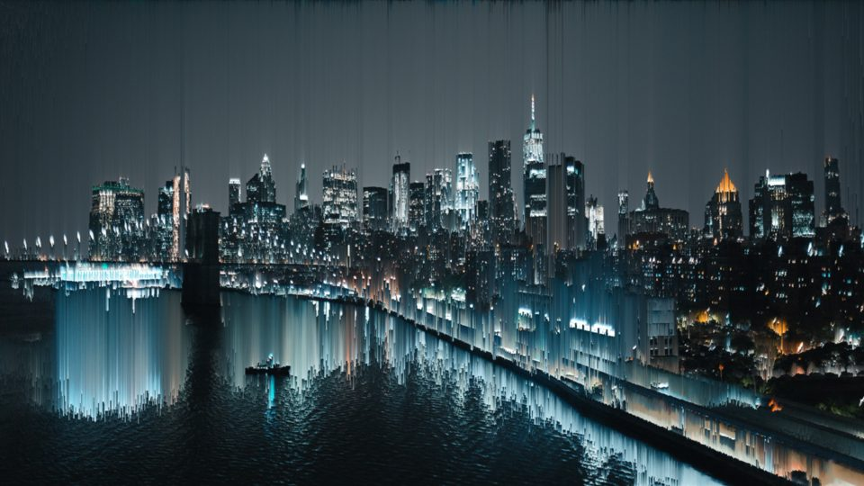<br>`sort --angle 270 --lower 0.1 --upper 0.9` | 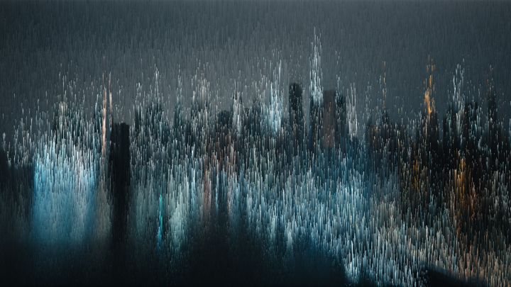<br>`sort --interval random --length 100 --angle 270 --reverse` | 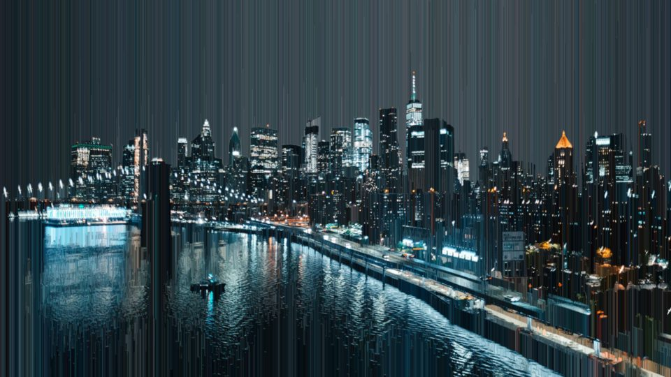<br>`sort --mode smear --interval edges --edge 0.12 --angle 270` |
| 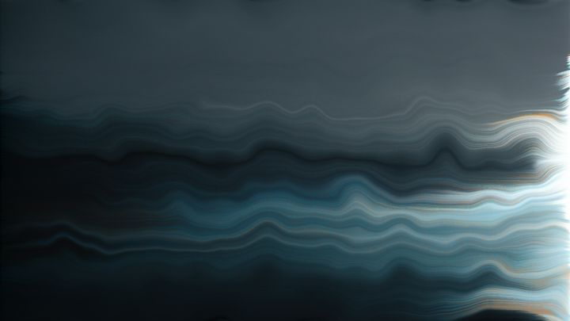<br>`sort --path flow --interval none` | 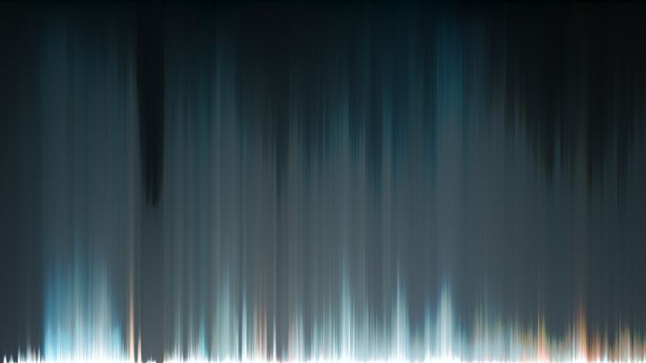<br>`sort --mode channels --interval none --angle 270` | 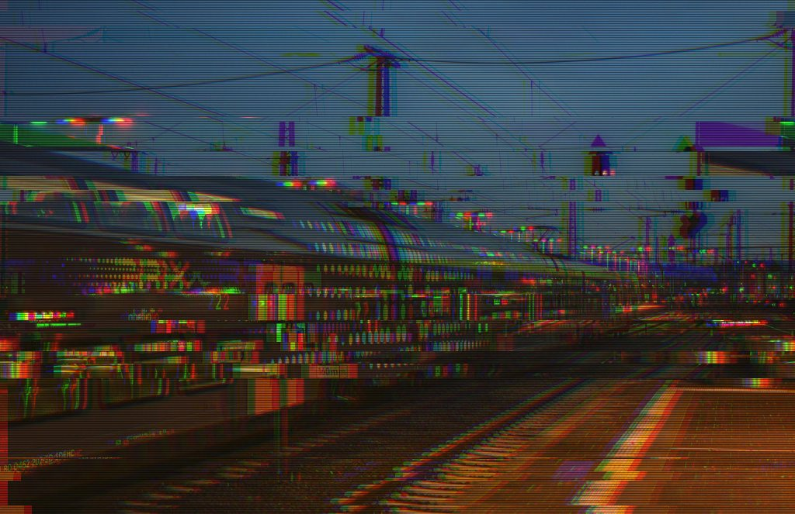<br>`glitch --slices 30 --shift 0.15` |
| 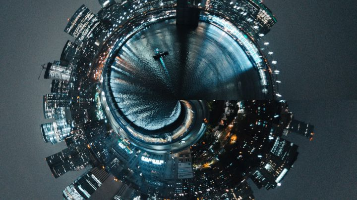<br>`polar` | 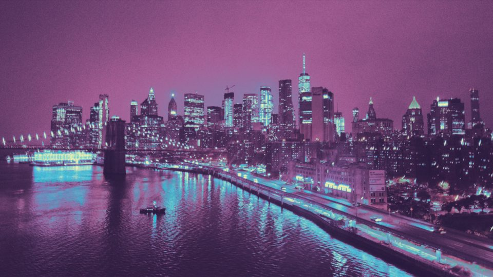<br>`@vaporwave` | 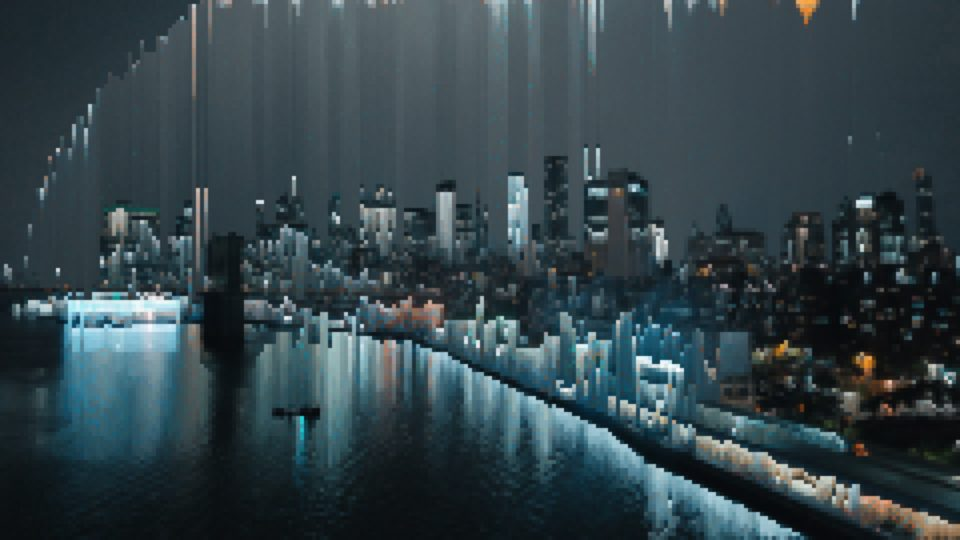<br>`@chunky` |

## Project structure

```text
sortmancy/
├── sortmancy.go          shortcuts: Sort, Apply, ApplyFile
├── sorter/              pixel sorting engine: keys, intervals, paths, modes
├── effects/             color, glitch, distortion, dithering, artistic and geometry effects
├── pipeline/            operation registry, "op | op" parser, presets, animation
├── imageio/             load and save images and animated GIFs
├── internal/imgutil/    shared low-level helpers (not public API)
├── cmd/sortmancy/        the command line tool
├── tools/gallery/       generates the docs gallery and checks CLI against library output
├── playground/          the browser playground (compiled to WebAssembly)
├── site/                the documentation site (Hugo + Hextra)
└── img/                 sample image and README highlights (not part of the Go module)
```

## Development

```bash
go test ./...                                   # run tests
go test -race ./...                             # run tests with the race detector
go test -bench . ./sorter                       # benchmarks
go test -fuzz FuzzParse -fuzztime 30s ./pipeline   # fuzz the pipeline parser
```

### Documentation site

The site lives in [site/](site) and is deployed to GitHub Pages on every push to `main`.
The gallery, the operations reference and their images are generated, not committed.

```bash
go run ./tools/gallery/gensnippets   # after changing tools/gallery/catalog: regenerate the Go snippets
go run ./tools/gallery               # build the playground, render all examples, check CLI == library
go run ./tools/gallery -examples=false   # only rebuild the WebAssembly playground (a few seconds)
hugo server --source site            # preview at http://localhost:1313/sortmancy/
go run ./tools/gallery -site "" -readme img/examples   # refresh the README highlight images
```

## License

[MIT](LICENSE)
