# Examples

Every example starts from [img/city/city.jpg](../img/city/city.jpg). Each one shows the command line
call and the equivalent library code; both produce the same image.

The library snippets assume the image was loaded and the result is saved like this:

```go
img, err := imageio.Load("img/city/city.jpg")
// ... snippet producing out ...
err = imageio.Save("out.jpg", out, imageio.Options{})
```

Images in this page are scaled down to at most 960 pixels wide to keep the repository small.

## Contents

- [Sorting: direction and threshold](#sorting-direction-and-threshold)
- [Sorting: keys](#sorting-keys)
- [Sorting: intervals](#sorting-intervals)
- [Sorting: paths](#sorting-paths)
- [Sorting: modes](#sorting-modes)
- [Color](#color)
- [Glitch](#glitch)
- [Retro](#retro)
- [Artistic](#artistic)
- [Geometry and filters](#geometry-and-filters)
- [Presets](#presets)
- [Pipelines](#pipelines)
- [Animation](#animation)

| | |
|-|-|
|  | **Original**<br>`img/city/city.jpg` |

## Sorting: direction and threshold

### Default settings


```bash
gopxsort sort -i city.jpg -o out.jpg
```

```go
out := sorter.Sort(img, sorter.Options{})
```

### Horizontal

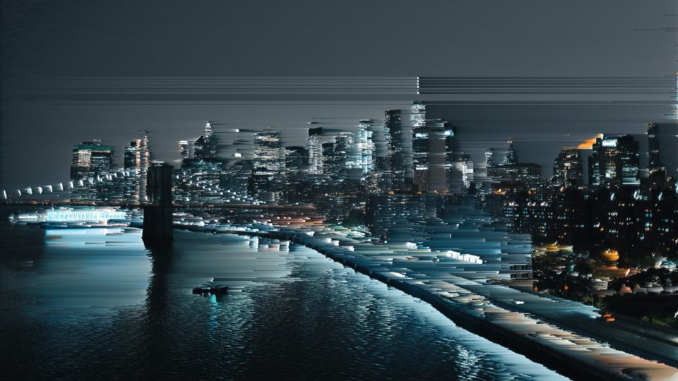

```bash
gopxsort sort -i city.jpg -o out.jpg --lower 0.1 --upper 0.9
```

```go
out := sorter.Sort(img, sorter.Options{
	Interval: sorter.Threshold(0.1, 0.9),
})
```

### Vertical (top to bottom)


```bash
gopxsort sort -i city.jpg -o out.jpg --angle 270 --lower 0.1 --upper 0.9
```

```go
out := sorter.Sort(img, sorter.Options{
	Interval: sorter.Threshold(0.1, 0.9),
	Path:     sorter.Linear(270),
})
```

### Diagonal 45°

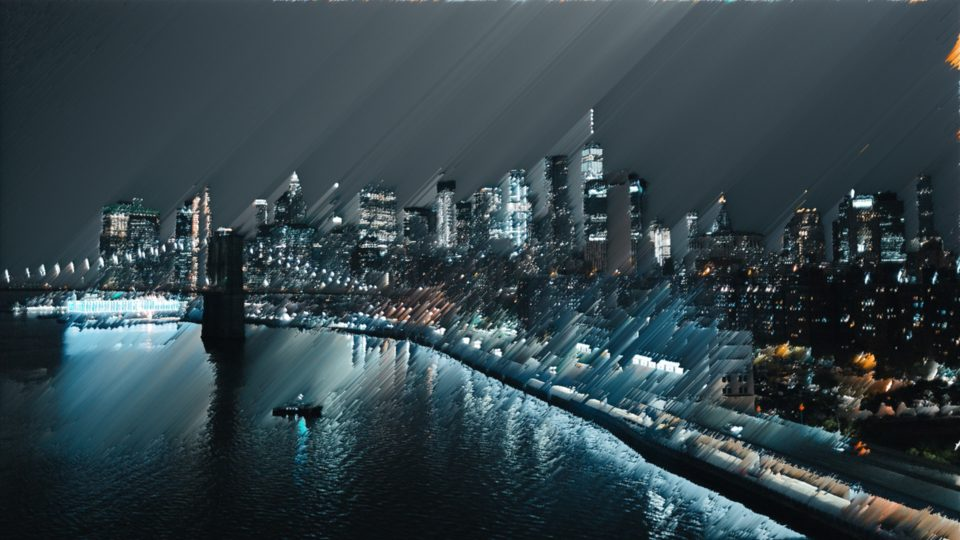

```bash
gopxsort sort -i city.jpg -o out.jpg --angle 45 --lower 0.1
```

```go
out := sorter.Sort(img, sorter.Options{
	Interval: sorter.Threshold(0.1, 0.8),
	Path:     sorter.Linear(45),
})
```

### Diagonal 135°

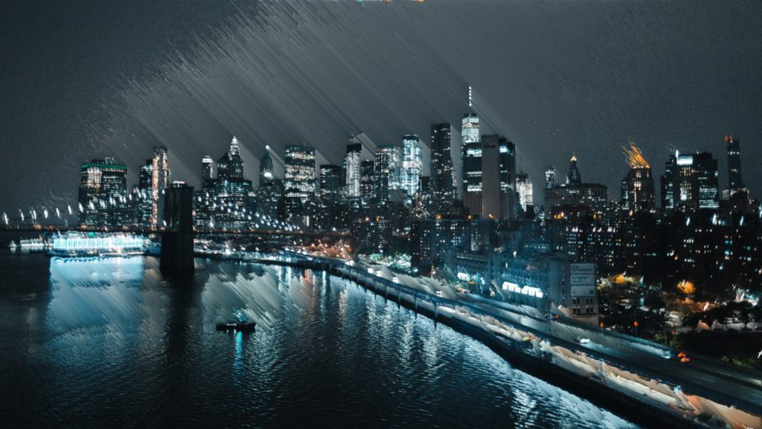

```bash
gopxsort sort -i city.jpg -o out.jpg --angle 135 --lower 0.2
```

```go
out := sorter.Sort(img, sorter.Options{
	Interval: sorter.Threshold(0.2, 0.8),
	Path:     sorter.Linear(135),
})
```

### Every pixel, whole rows


```bash
gopxsort sort -i city.jpg -o out.jpg --interval none
```

```go
out := sorter.Sort(img, sorter.Options{
	Interval: sorter.None(),
})
```

### Every pixel, whole columns

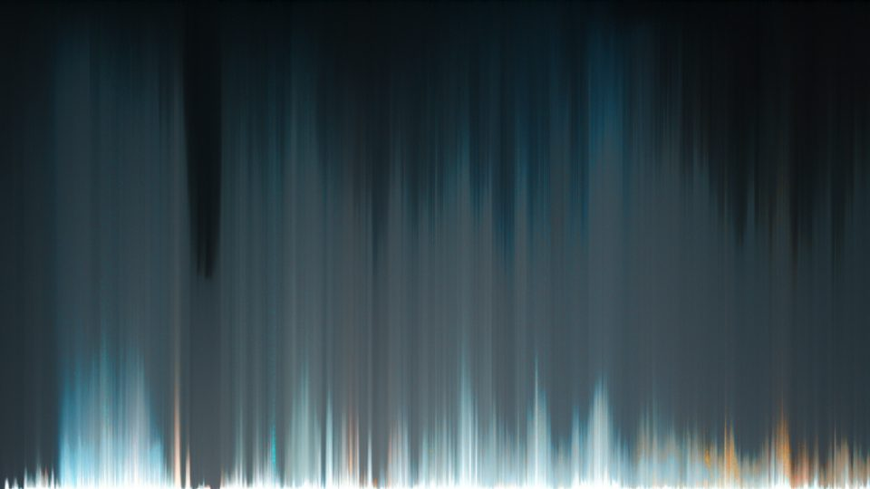

```bash
gopxsort sort -i city.jpg -o out.jpg --interval none --angle 270
```

```go
out := sorter.Sort(img, sorter.Options{
	Interval: sorter.None(),
	Path:     sorter.Linear(270),
})
```

### Classic luminance sort (like the original gopxsort)


```bash
gopxsort sort -i city.jpg -o out.jpg --interval none --key luminance
```

```go
out := sorter.Sort(img, sorter.Options{
	Key:      sorter.Luminance,
	Interval: sorter.None(),
})
```

### Reversed (bright to dark)

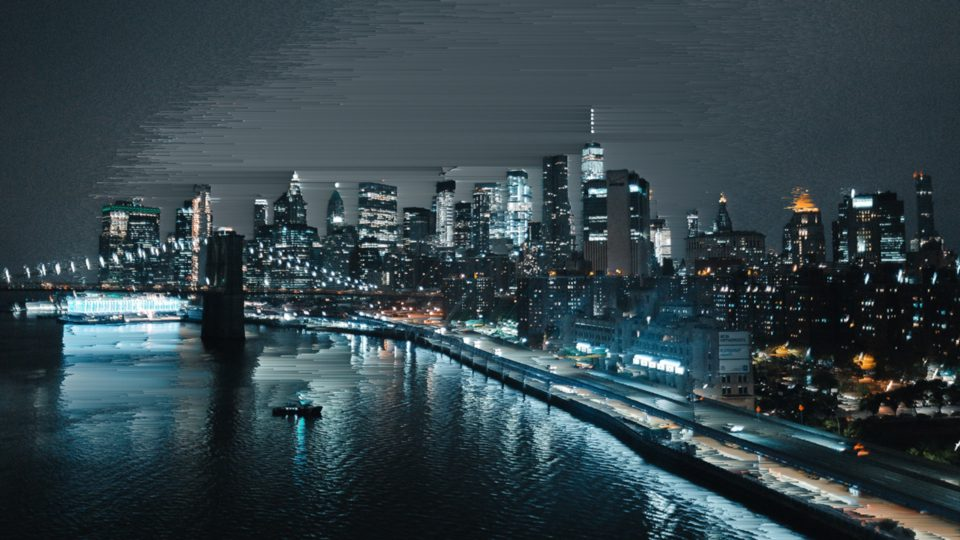

```bash
gopxsort sort -i city.jpg -o out.jpg --lower 0.2 --reverse
```

```go
out := sorter.Sort(img, sorter.Options{
	Interval: sorter.Threshold(0.2, 0.8),
	Reverse:  true,
})
```

### Only bright pixels


```bash
gopxsort sort -i city.jpg -o out.jpg --lower 0.6 --upper 1
```

```go
out := sorter.Sort(img, sorter.Options{
	Interval: sorter.Threshold(0.6, 1),
})
```

### Only dark pixels

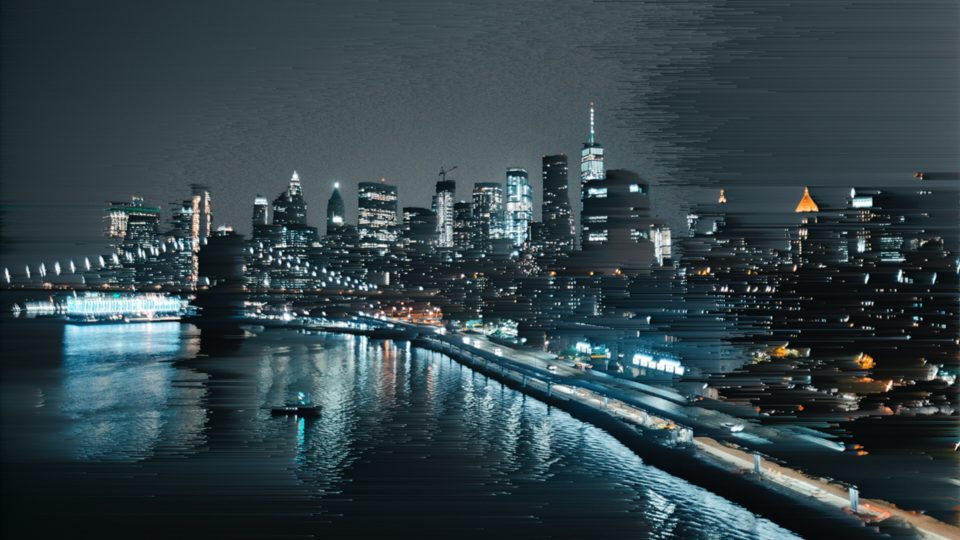

```bash
gopxsort sort -i city.jpg -o out.jpg --lower 0 --upper 0.35
```

```go
out := sorter.Sort(img, sorter.Options{
	Interval: sorter.Threshold(0, 0.35),
})
```

### Threshold on hue instead of lightness

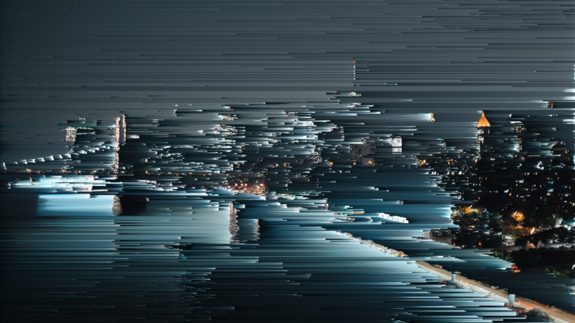

```bash
gopxsort sort -i city.jpg -o out.jpg --threshold-key hue --lower 0.4 --upper 0.7
```

```go
out := sorter.Sort(img, sorter.Options{
	Interval: sorter.ThresholdBy(sorter.Hue, 0.4, 0.7),
})
```

### Skip half of the spans


```bash
gopxsort sort -i city.jpg -o out.jpg --interval none --randomness 0.5 --seed 7
```

```go
out := sorter.Sort(img, sorter.Options{
	Interval:   sorter.None(),
	Randomness: 0.5,
	Seed:       7,
})
```

## Sorting: keys

### Key: hue

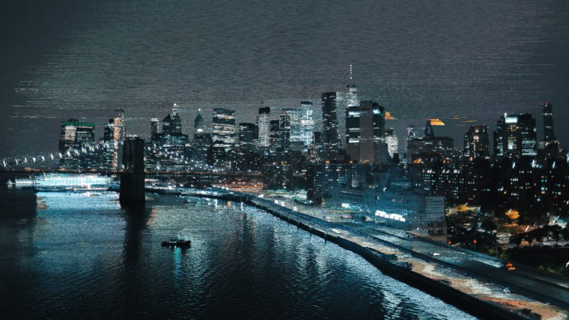

```bash
gopxsort sort -i city.jpg -o out.jpg --key hue --lower 0.15 --upper 0.95
```

```go
out := sorter.Sort(img, sorter.Options{
	Key:      sorter.Hue,
	Interval: sorter.Threshold(0.15, 0.95),
})
```

### Key: saturation


```bash
gopxsort sort -i city.jpg -o out.jpg --key saturation --lower 0.15 --upper 0.95
```

```go
out := sorter.Sort(img, sorter.Options{
	Key:      sorter.Saturation,
	Interval: sorter.Threshold(0.15, 0.95),
})
```

### Key: value


```bash
gopxsort sort -i city.jpg -o out.jpg --key value --lower 0.15 --upper 0.95
```

```go
out := sorter.Sort(img, sorter.Options{
	Key:      sorter.Value,
	Interval: sorter.Threshold(0.15, 0.95),
})
```

### Key: intensity

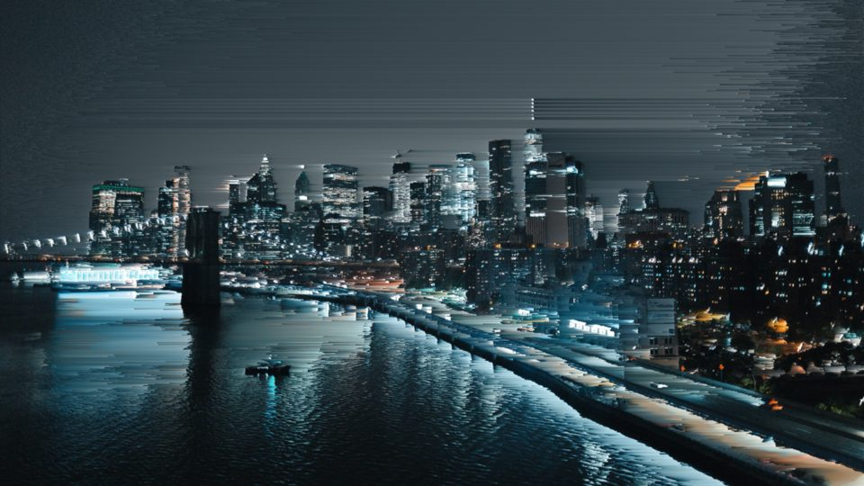

```bash
gopxsort sort -i city.jpg -o out.jpg --key intensity --lower 0.15 --upper 0.95
```

```go
out := sorter.Sort(img, sorter.Options{
	Key:      sorter.Intensity,
	Interval: sorter.Threshold(0.15, 0.95),
})
```

### Key: minimum


```bash
gopxsort sort -i city.jpg -o out.jpg --key minimum --lower 0.15 --upper 0.95
```

```go
out := sorter.Sort(img, sorter.Options{
	Key:      sorter.Minimum,
	Interval: sorter.Threshold(0.15, 0.95),
})
```

### Key: chroma


```bash
gopxsort sort -i city.jpg -o out.jpg --key chroma --lower 0.15 --upper 0.95
```

```go
out := sorter.Sort(img, sorter.Options{
	Key:      sorter.Chroma,
	Interval: sorter.Threshold(0.15, 0.95),
})
```

### Key: red


```bash
gopxsort sort -i city.jpg -o out.jpg --key red --lower 0.15 --upper 0.95
```

```go
out := sorter.Sort(img, sorter.Options{
	Key:      sorter.Red,
	Interval: sorter.Threshold(0.15, 0.95),
})
```

### Key: green


```bash
gopxsort sort -i city.jpg -o out.jpg --key green --lower 0.15 --upper 0.95
```

```go
out := sorter.Sort(img, sorter.Options{
	Key:      sorter.Green,
	Interval: sorter.Threshold(0.15, 0.95),
})
```

### Key: blue


```bash
gopxsort sort -i city.jpg -o out.jpg --key blue --lower 0.15 --upper 0.95
```

```go
out := sorter.Sort(img, sorter.Options{
	Key:      sorter.Blue,
	Interval: sorter.Threshold(0.15, 0.95),
})
```

## Sorting: intervals

### Random intervals

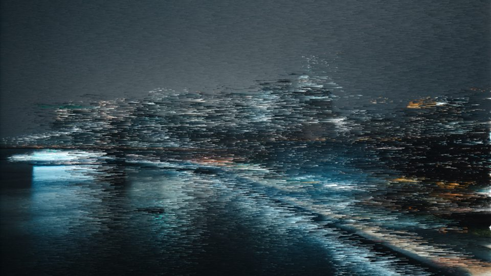

```bash
gopxsort sort -i city.jpg -o out.jpg --interval random --length 80 --seed 7
```

```go
out := sorter.Sort(img, sorter.Options{
	Interval: sorter.Random(80),
	Seed:     7,
})
```

### Random intervals, vertical, reversed


```bash
gopxsort sort -i city.jpg -o out.jpg --interval random --length 100 --angle 270 --reverse --seed 7
```

```go
out := sorter.Sort(img, sorter.Options{
	Interval: sorter.Random(100),
	Path:     sorter.Linear(270),
	Reverse:  true,
	Seed:     7,
})
```

### Wave intervals


```bash
gopxsort sort -i city.jpg -o out.jpg --interval waves --length 80 --seed 7
```

```go
out := sorter.Sort(img, sorter.Options{
	Interval: sorter.Waves(80),
	Seed:     7,
})
```

### Between edges


```bash
gopxsort sort -i city.jpg -o out.jpg --interval edges --edge 0.2
```

```go
out := sorter.Sort(img, sorter.Options{
	Interval: sorter.Edges(0.2),
})
```

### By hue, between edges


```bash
gopxsort sort -i city.jpg -o out.jpg --key hue --interval edges --edge 0.15
```

```go
out := sorter.Sort(img, sorter.Options{
	Key:      sorter.Hue,
	Interval: sorter.Edges(0.15),
})
```

## Sorting: paths

### Sine-wave path

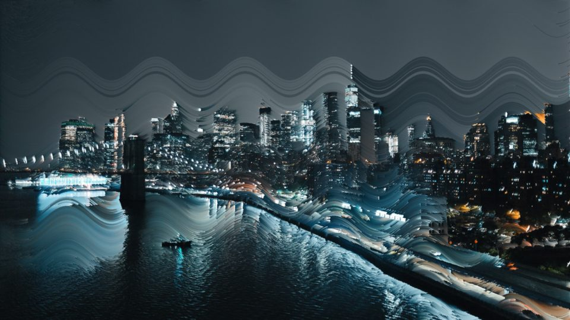

```bash
gopxsort sort -i city.jpg -o out.jpg --path wave --amplitude 40 --wavelength 300 --lower 0.1
```

```go
out := sorter.Sort(img, sorter.Options{
	Interval: sorter.Threshold(0.1, 0.8),
	Path:     sorter.Wave(40, 300, false),
})
```

### Vertical sine-wave path

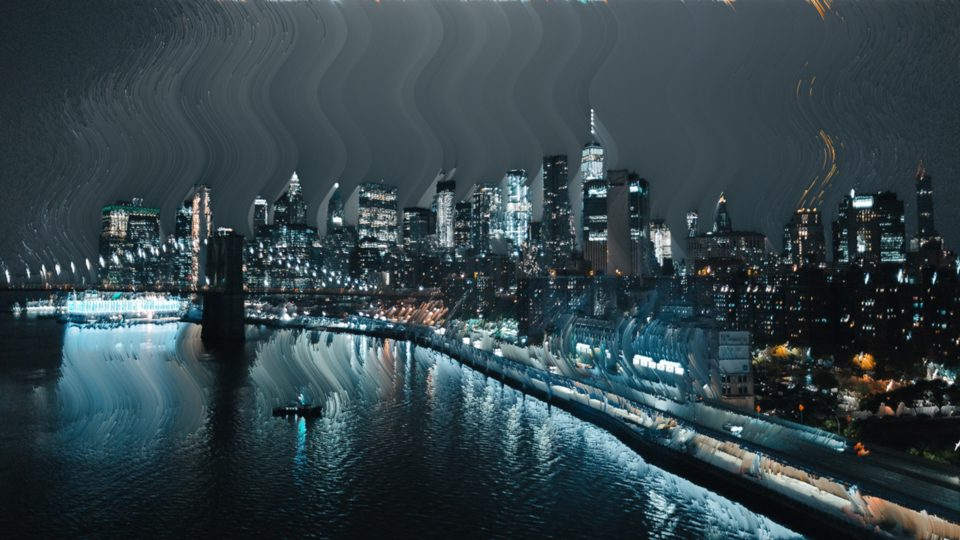

```bash
gopxsort sort -i city.jpg -o out.jpg --path wave --amplitude 30 --wavelength 250 --vertical --lower 0.15
```

```go
out := sorter.Sort(img, sorter.Options{
	Interval: sorter.Threshold(0.15, 0.8),
	Path:     sorter.Wave(30, 250, true),
})
```

### Spiral


```bash
gopxsort sort -i city.jpg -o out.jpg --path spiral --spacing 6 --interval edges --edge 0.15
```

```go
out := sorter.Sort(img, sorter.Options{
	Interval: sorter.Edges(0.15),
	Path:     sorter.Spiral(0.5, 0.5, 6),
})
```

### Concentric rings

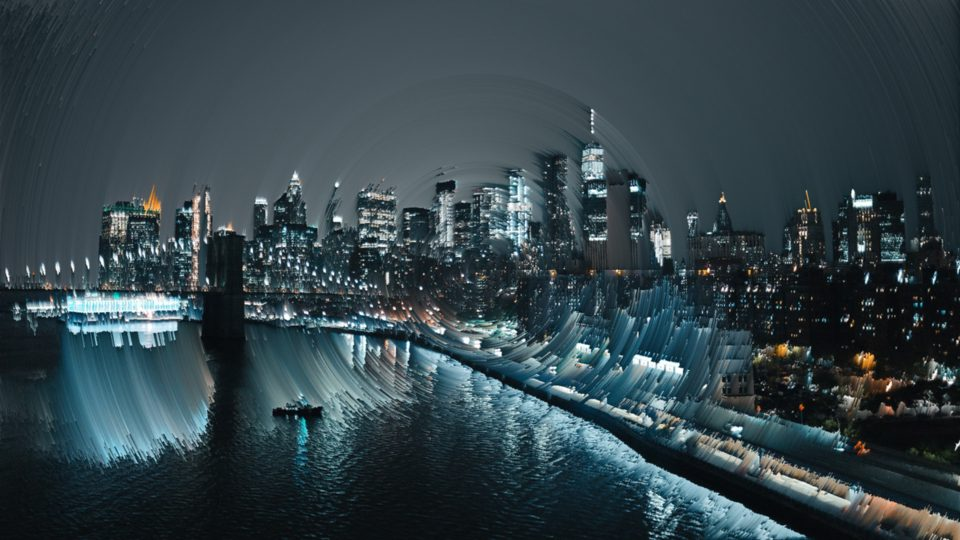

```bash
gopxsort sort -i city.jpg -o out.jpg --path concentric --lower 0.1
```

```go
out := sorter.Sort(img, sorter.Options{
	Interval: sorter.Threshold(0.1, 0.8),
	Path:     sorter.Concentric(0.5, 0.5),
})
```

### Radial rays

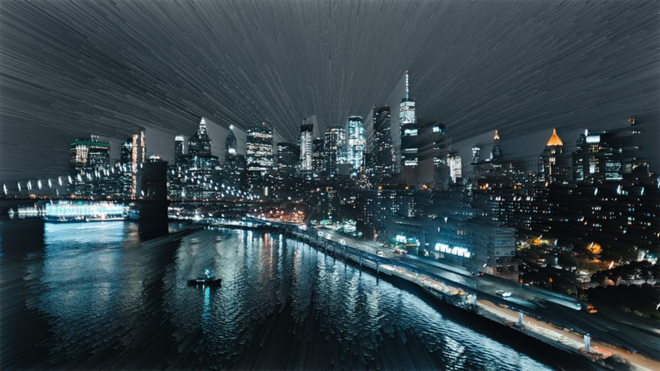

```bash
gopxsort sort -i city.jpg -o out.jpg --path radial --interval edges --edge 0.1
```

```go
out := sorter.Sort(img, sorter.Options{
	Interval: sorter.Edges(0.1),
	Path:     sorter.Radial(0.5, 0.5),
})
```

## Sorting: modes

### Shuffle


```bash
gopxsort sort -i city.jpg -o out.jpg --mode shuffle --interval edges --edge 0.15 --angle 270 --seed 7
```

```go
out := sorter.Sort(img, sorter.Options{
	Interval: sorter.Edges(0.15),
	Path:     sorter.Linear(270),
	Mode:     sorter.ModeShuffle,
	Seed:     7,
})
```

### Average


```bash
gopxsort sort -i city.jpg -o out.jpg --mode average --interval edges --edge 0.15 --angle 270
```

```go
out := sorter.Sort(img, sorter.Options{
	Interval: sorter.Edges(0.15),
	Path:     sorter.Linear(270),
	Mode:     sorter.ModeAverage,
})
```

### Gradient

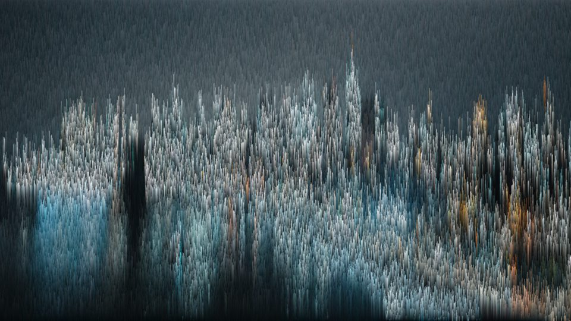

```bash
gopxsort sort -i city.jpg -o out.jpg --mode gradient --interval random --length 60 --angle 90 --seed 7
```

```go
out := sorter.Sort(img, sorter.Options{
	Interval: sorter.Random(60),
	Path:     sorter.Linear(90),
	Mode:     sorter.ModeGradient,
	Seed:     7,
})
```

### Smear


```bash
gopxsort sort -i city.jpg -o out.jpg --mode smear --interval edges --edge 0.12 --angle 270
```

```go
out := sorter.Sort(img, sorter.Options{
	Interval: sorter.Edges(0.12),
	Path:     sorter.Linear(270),
	Mode:     sorter.ModeSmear,
})
```

## Color

### Invert

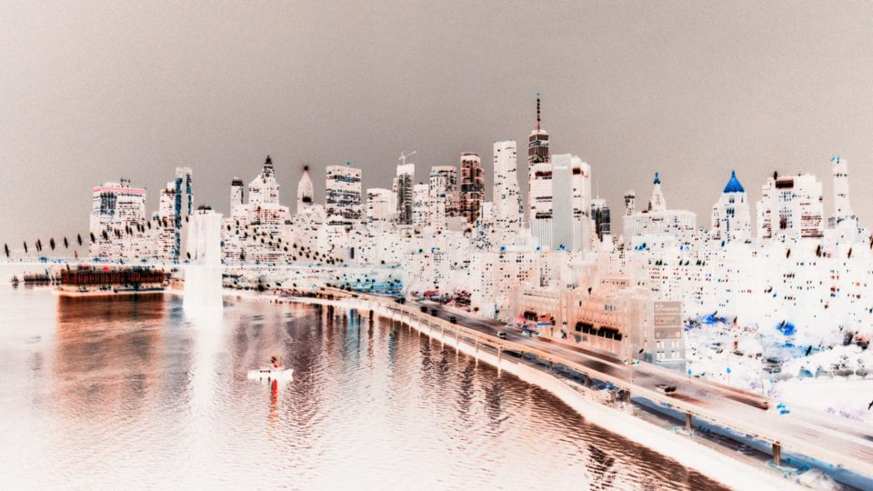

```bash
gopxsort invert -i city.jpg -o out.jpg
```

```go
out := effects.Invert(img)
```

### Grayscale


```bash
gopxsort grayscale -i city.jpg -o out.jpg
```

```go
out := effects.Grayscale(img)
```

### Threshold

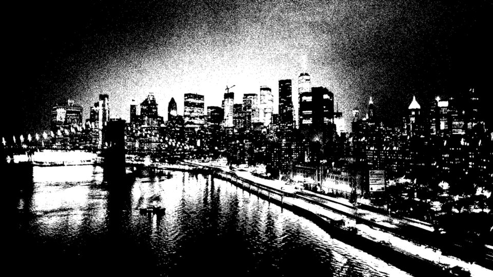

```bash
gopxsort threshold -i city.jpg -o out.jpg --level 0.3
```

```go
out := effects.Threshold(img, 0.3)
```

### Posterize

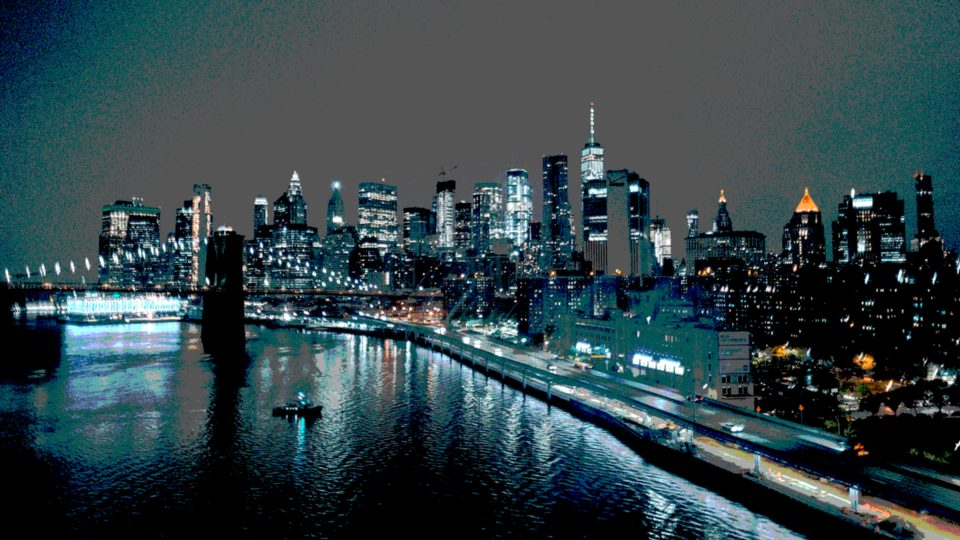

```bash
gopxsort posterize -i city.jpg -o out.jpg --levels 4
```

```go
out := effects.Posterize(img, 4)
```

### Brightness


```bash
gopxsort brightness -i city.jpg -o out.jpg --amount 0.2
```

```go
out := effects.Brightness(img, 0.2)
```

### Contrast


```bash
gopxsort contrast -i city.jpg -o out.jpg --factor 1.5
```

```go
out := effects.Contrast(img, 1.5)
```

### Gamma


```bash
gopxsort gamma -i city.jpg -o out.jpg --gamma 1.8
```

```go
out := effects.Gamma(img, 1.8)
```

### Saturation


```bash
gopxsort saturation -i city.jpg -o out.jpg --factor 2
```

```go
out := effects.Saturation(img, 2)
```

### Hue rotation


```bash
gopxsort hue -i city.jpg -o out.jpg --degrees 180
```

```go
out := effects.HueShift(img, 180)
```

### Solarize


```bash
gopxsort solarize -i city.jpg -o out.jpg --threshold 0.3
```

```go
out := effects.Solarize(img, 0.3)
```

### Channel swap


```bash
gopxsort swap -i city.jpg -o out.jpg --order bgr
```

```go
out, err := effects.ChannelSwap(img, "bgr")
```

### Gradient map

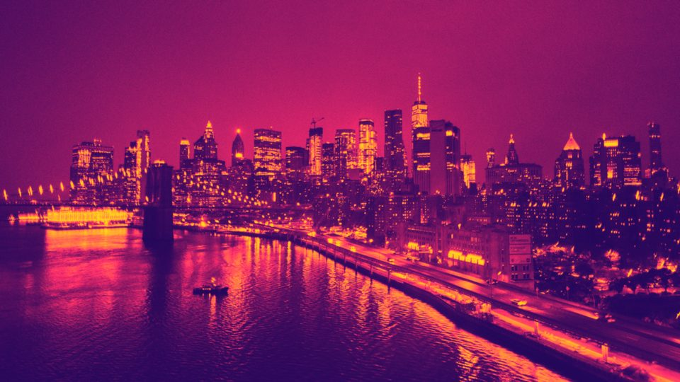

```bash
gopxsort gradientmap -i city.jpg -o out.jpg --colors "#120458,#ff2a6d,#ffd319"
```

```go
colors, err := effects.ParsePalette("#120458,#ff2a6d,#ffd319")
out := effects.GradientMap(img, colors)
```

## Glitch

### Slice glitch


```bash
gopxsort glitch -i city.jpg -o out.jpg --slices 30 --shift 0.15 --seed 7
```

```go
out := effects.Glitch(img, 30, 0.15, 7)
```

### RGB split

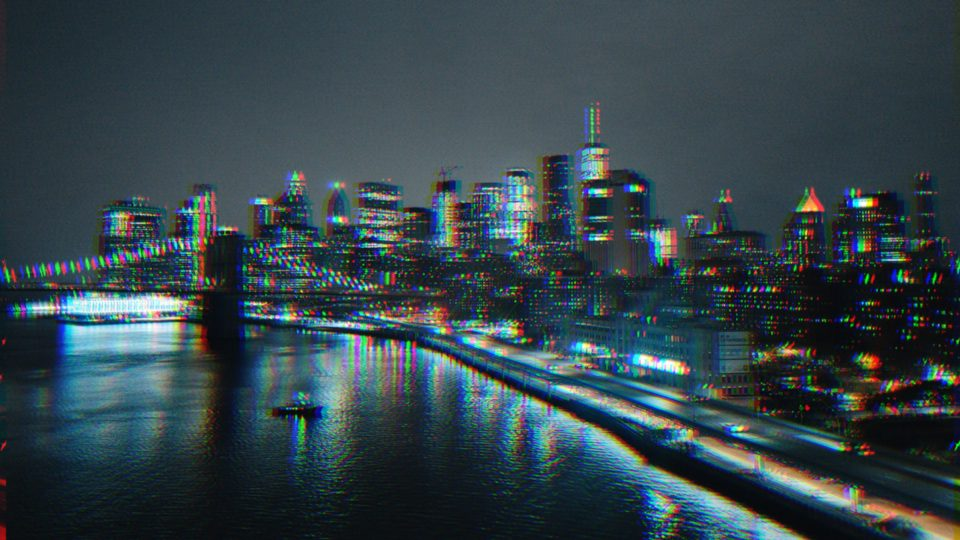

```bash
gopxsort shift -i city.jpg -o out.jpg --r 12,0 --b -12,0
```

```go
out := effects.ChannelShift(img, image.Pt(12, 0), image.Pt(0, 0), image.Pt(-12, 0))
```

### Chromatic aberration


```bash
gopxsort aberration -i city.jpg -o out.jpg --strength 0.015
```

```go
out := effects.ChromaticAberration(img, 0.015)
```

### JPEG corruption


```bash
gopxsort jpeg -i city.jpg -o out.jpg --amount 15 --quality 40 --seed 2
```

```go
out, err := effects.JPEGCorrupt(img, 15, 40, 2)
```

### Block shuffle


```bash
gopxsort blocks -i city.jpg -o out.jpg --size 48 --amount 0.15 --seed 7
```

```go
out := effects.BlockShuffle(img, 48, 0.15, 7)
```

### Melt

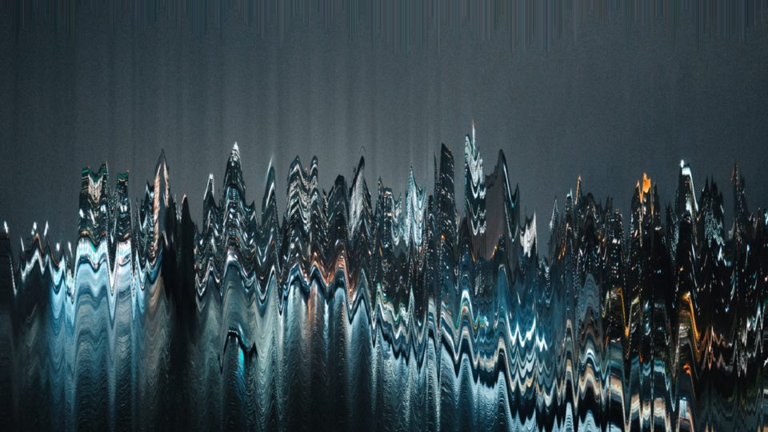

```bash
gopxsort melt -i city.jpg -o out.jpg --shift 150 --seed 7
```

```go
out := effects.Melt(img, 150, 7)
```

### Wave displacement


```bash
gopxsort wave -i city.jpg -o out.jpg --amplitude 10 --wavelength 60
```

```go
out := effects.Wave(img, 10, 60, false)
```

### Scanlines


```bash
gopxsort scanlines -i city.jpg -o out.jpg --spacing 3 --intensity 0.4
```

```go
out := effects.Scanlines(img, 3, 0.4)
```

### Noise


```bash
gopxsort noise -i city.jpg -o out.jpg --amount 0.1 --seed 7
```

```go
out := effects.Noise(img, 0.1, false, 7)
```

## Retro

### Dithering with a palette

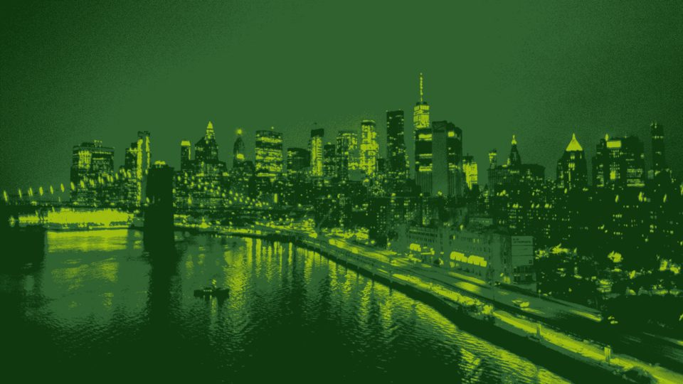

```bash
gopxsort dither -i city.jpg -o out.jpg --method atkinson --palette gameboy
```

```go
out := effects.Dither(img, effects.DitherOptions{
	Method:  effects.Atkinson,
	Palette: effects.Palettes["gameboy"],
})
```

### Ordered dithering, 1 bit per channel


```bash
gopxsort dither -i city.jpg -o out.jpg --method bayer4 --levels 2
```

```go
out := effects.Dither(img, effects.DitherOptions{
	Method: effects.Bayer4,
	Levels: 2,
})
```

### Median-cut quantization


```bash
gopxsort quantize -i city.jpg -o out.jpg --colors 8 --method floyd
```

```go
out := effects.Quantize(img, 8, effects.FloydSteinberg)
```

### Pixelate


```bash
gopxsort pixelate -i city.jpg -o out.jpg --size 12
```

```go
out := effects.Pixelate(img, 12)
```

## Artistic

### Color halftone


```bash
gopxsort halftone -i city.jpg -o out.jpg --size 8 --color
```

```go
out := effects.Halftone(img, 8, true)
```

### Black and white halftone

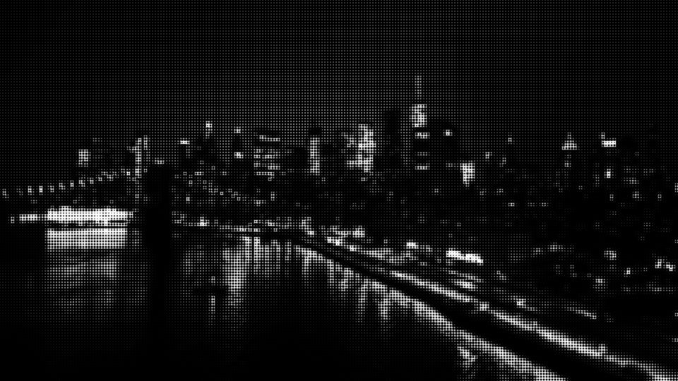

```bash
gopxsort halftone -i city.jpg -o out.jpg --size 8
```

```go
out := effects.Halftone(img, 8, false)
```

### Kaleidoscope


```bash
gopxsort kaleidoscope -i city.jpg -o out.jpg --segments 6
```

```go
out := effects.Kaleidoscope(img, 6, 0)
```

### Bloom


```bash
gopxsort bloom -i city.jpg -o out.jpg --threshold 0.5 --radius 16
```

```go
out := effects.Bloom(img, 0.5, 16, 1)
```

### Oil paint


```bash
gopxsort oilpaint -i city.jpg -o out.jpg --radius 5
```

```go
out := effects.OilPaint(img, 5)
```

### Mirror (quad)

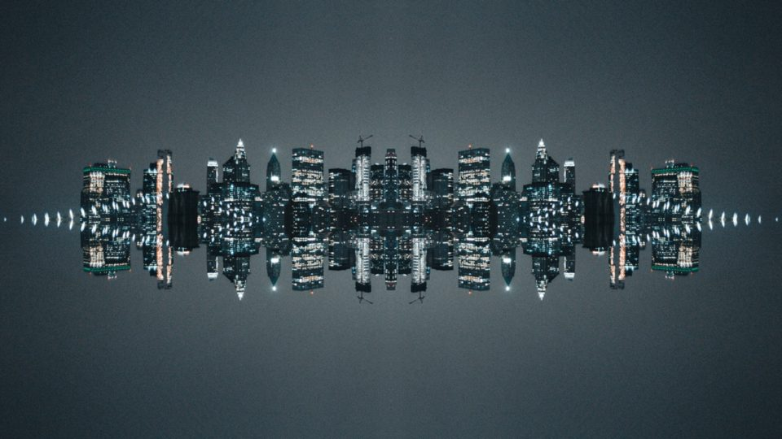

```bash
gopxsort mirror -i city.jpg -o out.jpg --mode quad
```

```go
out := effects.Mirror(img, effects.MirrorQuad)
```

## Geometry and filters

### Resize


```bash
gopxsort resize -i city.jpg -o out.jpg --width 320
```

```go
out := effects.Resize(img, 320, 180, effects.Bilinear)
```

### Crop


```bash
gopxsort crop -i city.jpg -o out.jpg --x 600 --y 200 --width 800 --height 450
```

```go
out := effects.Crop(img, image.Rect(600, 200, 1400, 650))
```

### Flip


```bash
gopxsort flip -i city.jpg -o out.jpg --axis h
```

```go
out := effects.FlipHorizontal(img)
```

### Rotate


```bash
gopxsort rotate -i city.jpg -o out.jpg --degrees 90
```

```go
out, err := effects.Rotate(img, 90)
```

### Blur


```bash
gopxsort blur -i city.jpg -o out.jpg --radius 6
```

```go
out := effects.BoxBlur(img, 6)
```

### Sharpen


```bash
gopxsort sharpen -i city.jpg -o out.jpg --amount 2 --radius 2
```

```go
out := effects.Sharpen(img, 2, 2)
```

### Edge detection

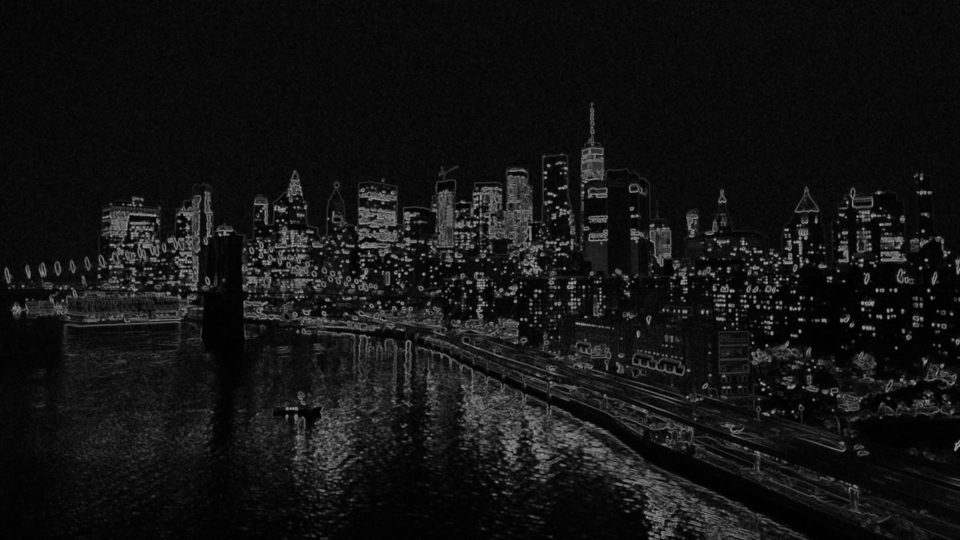

```bash
gopxsort edges -i city.jpg -o out.jpg
```

```go
out := effects.EdgeDetect(img)
```

### Vignette


```bash
gopxsort vignette -i city.jpg -o out.jpg --strength 0.8
```

```go
out := effects.Vignette(img, 0.8)
```

## Presets

### @classic


```bash
gopxsort @classic -i city.jpg -o out.jpg
```

```go
p, err := pipeline.ParseSeed("@classic", 7)
out, err := p.Apply(img)
```

### @vertical

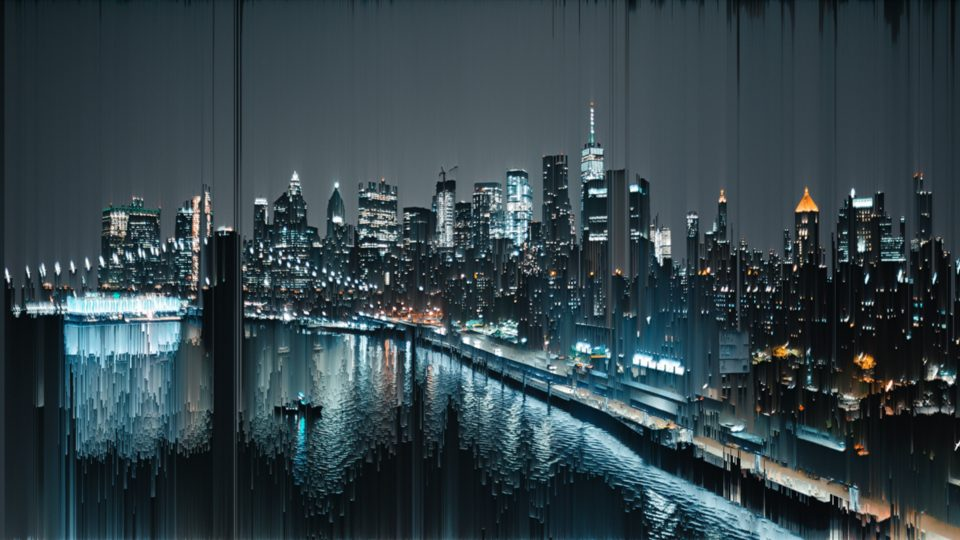

```bash
gopxsort @vertical -i city.jpg -o out.jpg
```

```go
p, err := pipeline.ParseSeed("@vertical", 7)
out, err := p.Apply(img)
```

### @spiral


```bash
gopxsort @spiral -i city.jpg -o out.jpg
```

```go
p, err := pipeline.ParseSeed("@spiral", 7)
out, err := p.Apply(img)
```

### @melt

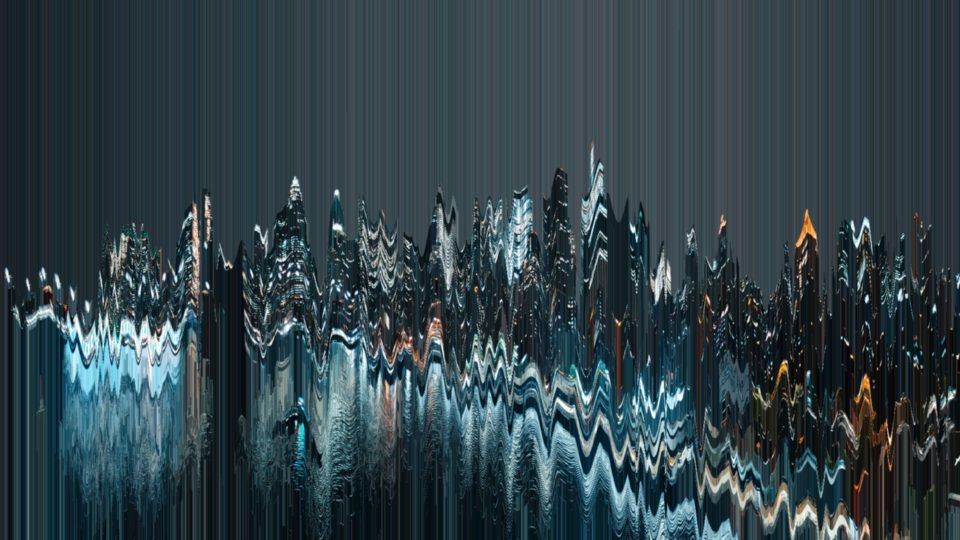

```bash
gopxsort @melt -i city.jpg -o out.jpg --seed 7
```

```go
p, err := pipeline.ParseSeed("@melt", 7)
out, err := p.Apply(img)
```

### @glitch

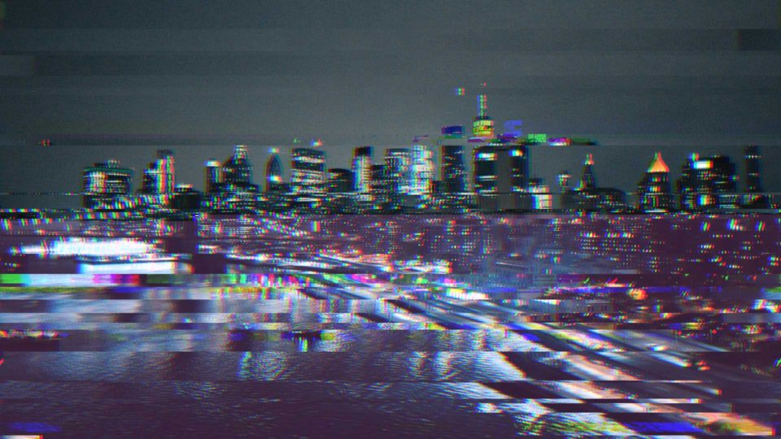

```bash
gopxsort @glitch -i city.jpg -o out.jpg --seed 7
```

```go
p, err := pipeline.ParseSeed("@glitch", 7)
out, err := p.Apply(img)
```

### @vhs

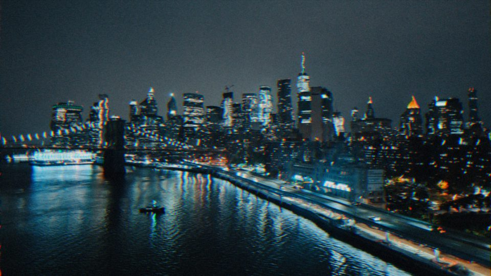

```bash
gopxsort @vhs -i city.jpg -o out.jpg --seed 7
```

```go
p, err := pipeline.ParseSeed("@vhs", 7)
out, err := p.Apply(img)
```

### @crt

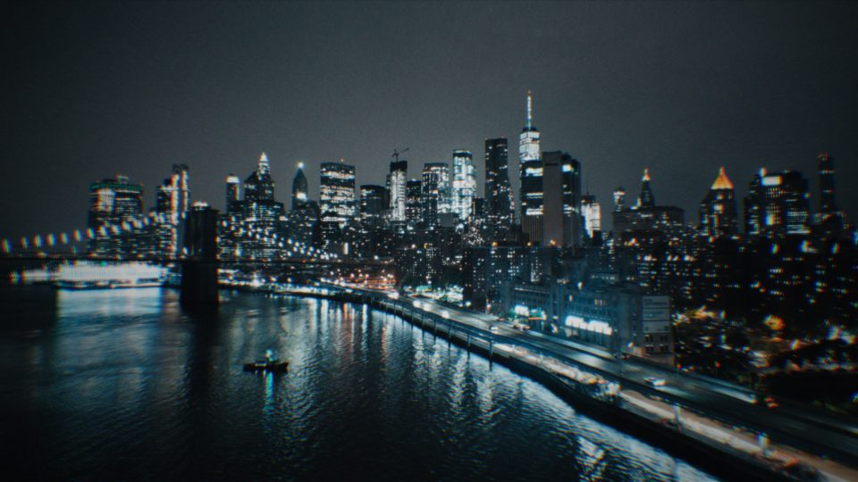

```bash
gopxsort @crt -i city.jpg -o out.jpg
```

```go
p, err := pipeline.ParseSeed("@crt", 7)
out, err := p.Apply(img)
```

### @vaporwave


```bash
gopxsort @vaporwave -i city.jpg -o out.jpg
```

```go
p, err := pipeline.ParseSeed("@vaporwave", 7)
out, err := p.Apply(img)
```

### @dream


```bash
gopxsort @dream -i city.jpg -o out.jpg
```

```go
p, err := pipeline.ParseSeed("@dream", 7)
out, err := p.Apply(img)
```

### @gameboy

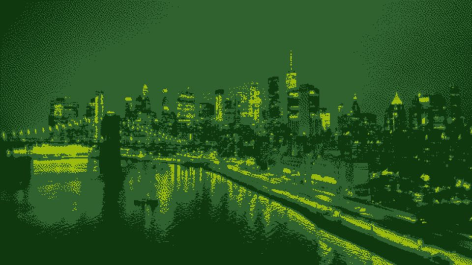

```bash
gopxsort @gameboy -i city.jpg -o out.jpg
```

```go
p, err := pipeline.ParseSeed("@gameboy", 7)
out, err := p.Apply(img)
```

### @8bit


```bash
gopxsort @8bit -i city.jpg -o out.jpg
```

```go
p, err := pipeline.ParseSeed("@8bit", 7)
out, err := p.Apply(img)
```

### @chunky


```bash
gopxsort @chunky -i city.jpg -o out.jpg
```

```go
p, err := pipeline.ParseSeed("@chunky", 7)
out, err := p.Apply(img)
```

### @newspaper


```bash
gopxsort @newspaper -i city.jpg -o out.jpg
```

```go
p, err := pipeline.ParseSeed("@newspaper", 7)
out, err := p.Apply(img)
```

### @oil


```bash
gopxsort @oil -i city.jpg -o out.jpg
```

```go
p, err := pipeline.ParseSeed("@oil", 7)
out, err := p.Apply(img)
```

## Pipelines

### Sort, split and scanlines

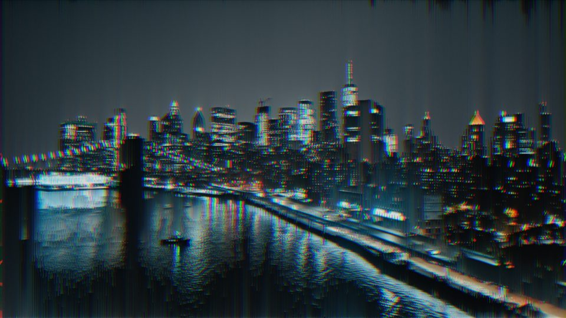

```bash
gopxsort run -i city.jpg -o out.jpg "sort angle=270 interval=edges edge=0.15 | shift | scanlines"
```

```go
p, err := pipeline.Parse("sort angle=270 interval=edges edge=0.15 | shift | scanlines")
out, err := p.Apply(img)
```

### Low-res sort scaled back up

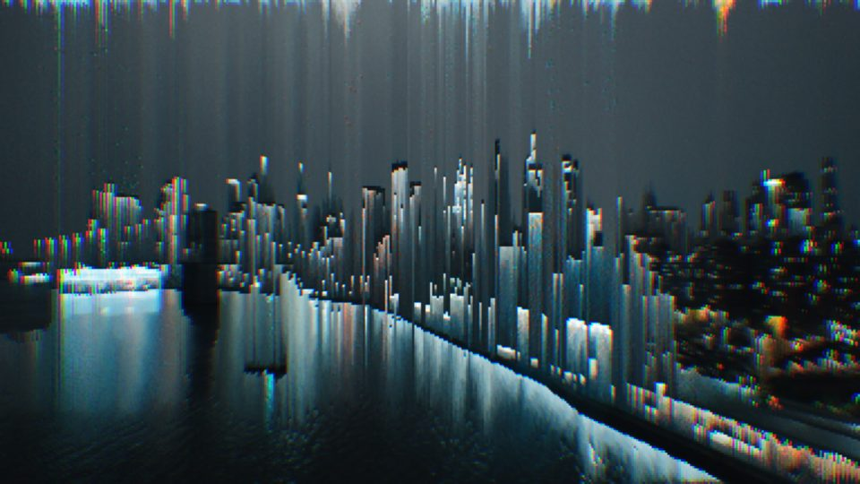

```bash
gopxsort run -i city.jpg -o out.jpg "resize scale=0.2 | sort angle=90 lower=0.1 | resize original filter=nearest | aberration"
```

```go
p, err := pipeline.Parse("resize scale=0.2 | sort angle=90 lower=0.1 | resize original filter=nearest | aberration")
out, err := p.Apply(img)
```

### Half-strength effect with mix


```bash
gopxsort run -i city.jpg -o out.jpg "sort key=hue lower=0.1 | gradientmap colors=vapor | mix 0.5"
```

```go
p, err := pipeline.Parse("sort key=hue lower=0.1 | gradientmap colors=vapor | mix 0.5")
out, err := p.Apply(img)
```

### Mix an effect with the original


```bash
gopxsort run -i city.jpg -o out.jpg "pixelate 24 | mix 0.5"
```

```go
out := effects.Mix(img, effects.Pixelate(img, 24), 0.5)
```

## Animation

### Threshold and angle sweep


```bash
gopxsort run -i city.jpg -o out.gif --frames 16 --pingpong --delay 90 --seed 7 "resize width=480 | sort angle={0..90} lower={0.05..0.5}"
```

```go
frames, err := pipeline.Animate([]image.Image{img},
	"resize width=480 | sort angle={0..90} lower={0.05..0.5}",
	pipeline.AnimateOptions{Frames: 16, PingPong: true, Seed: 7})
anim := &imageio.Animation{}
for _, f := range frames {
	anim.Frames = append(anim.Frames, f)
	anim.Delays = append(anim.Delays, 9)
}
err = imageio.SaveAnimation("out.gif", anim)
```

### Threshold sweep


```bash
gopxsort run -i city.jpg -o out.gif --frames 16 --pingpong --delay 90 --seed 7 "resize width=480 | sort lower={0.05..0.6}"
```

```go
frames, err := pipeline.Animate([]image.Image{img},
	"resize width=480 | sort lower={0.05..0.6}",
	pipeline.AnimateOptions{Frames: 16, PingPong: true, Seed: 7})
anim := &imageio.Animation{}
for _, f := range frames {
	anim.Frames = append(anim.Frames, f)
	anim.Delays = append(anim.Delays, 9)
}
err = imageio.SaveAnimation("out.gif", anim)
```

### Angle sweep

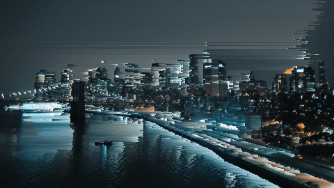

```bash
gopxsort run -i city.jpg -o out.gif --frames 16 --pingpong --delay 90 --seed 7 "resize width=480 | sort angle={0..180} lower=0.2"
```

```go
frames, err := pipeline.Animate([]image.Image{img},
	"resize width=480 | sort angle={0..180} lower=0.2",
	pipeline.AnimateOptions{Frames: 16, PingPong: true, Seed: 7})
anim := &imageio.Animation{}
for _, f := range frames {
	anim.Frames = append(anim.Frames, f)
	anim.Delays = append(anim.Delays, 9)
}
err = imageio.SaveAnimation("out.gif", anim)
```

### Changing glitch

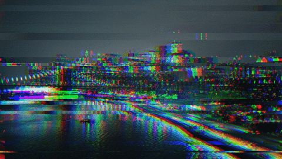

```bash
gopxsort run -i city.jpg -o out.gif --frames 16 --pingpong --delay 90 --seed 7 "resize width=480 | glitch seed={1..16} | shift"
```

```go
frames, err := pipeline.Animate([]image.Image{img},
	"resize width=480 | glitch seed={1..16} | shift",
	pipeline.AnimateOptions{Frames: 16, PingPong: true, Seed: 7})
anim := &imageio.Animation{}
for _, f := range frames {
	anim.Frames = append(anim.Frames, f)
	anim.Delays = append(anim.Delays, 9)
}
err = imageio.SaveAnimation("out.gif", anim)
```

### Rotating kaleidoscope

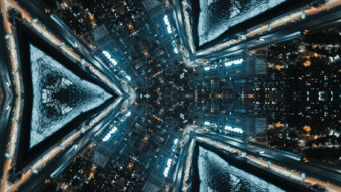

```bash
gopxsort run -i city.jpg -o out.gif --frames 16 --pingpong --delay 90 --seed 7 "resize width=480 | kaleidoscope rotation={0..60}"
```

```go
frames, err := pipeline.Animate([]image.Image{img},
	"resize width=480 | kaleidoscope rotation={0..60}",
	pipeline.AnimateOptions{Frames: 16, PingPong: true, Seed: 7})
anim := &imageio.Animation{}
for _, f := range frames {
	anim.Frames = append(anim.Frames, f)
	anim.Delays = append(anim.Delays, 9)
}
err = imageio.SaveAnimation("out.gif", anim)
```
